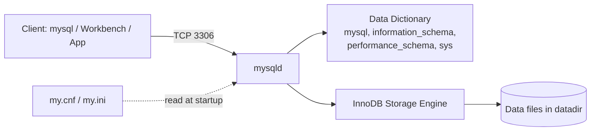
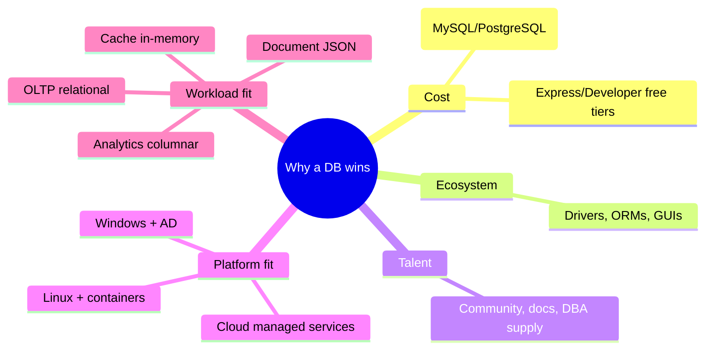
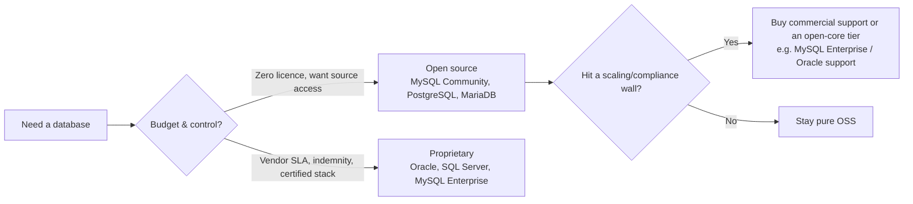
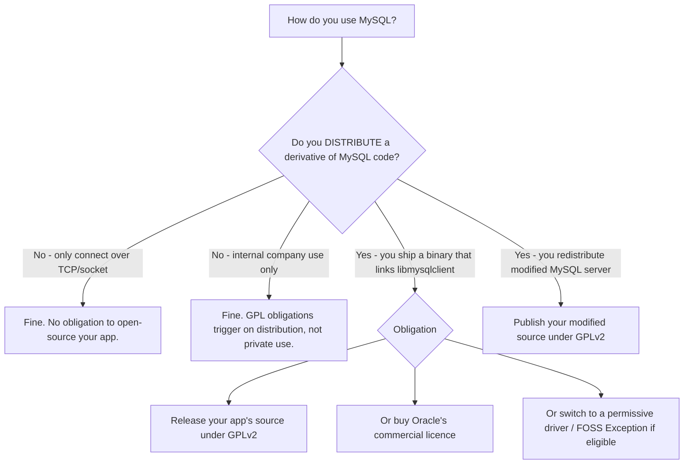

🔵 **DATABASE ADMINISTRATION (MySQL 8) — WEEK 1: INTRODUCTION TO DATABASES & MySQL**
**Complete Exam-Prep Package — Part 1 (Extensive Notes) + Part 2 (Master Summary)**

> 📌 **MUST KNOW — Assumption stated up front:** Your upload gave me quiz question *stems* but not the multiple-choice *option lists*. Where options were missing I reconstruct the most likely distractors and label them clearly as **[RECONSTRUCTED — verify against your slide]**. Every hard fact (port, file names, license) is source-accurate regardless of the options.
> 🧪 **TRY IT — Environment note:** All client commands below are written for MySQL 8.0/8.4 on Windows Server + Linux. Your `VERSION()` string will differ (e.g. `8.0.43`, `8.4.x`) — that difference is expected and is *not* an error.

---

# 🟢 TOPIC 1. Database & DBMS Fundamentals (Introduction to Databases)

## 1. Big Picture (2–4 sentences)
A **database** is an organised collection of persistent data; a **DBMS** is the software that stores, secures, and serves that data. MySQL is a **relational DBMS (RDBMS)** that speaks **SQL**, runs as a **client/server** service, and answers requests over **TCP/IP port 3306**. This topic is the foundation for everything in the DBA course: if you can't explain client/server + the config file + the port, every later lab (W2 services, W4 privileges, W5 replication) collapses.

## 2. Key Terms and Definitions

| Term | Precise definition | Common confusion with |
|---|---|---|
| **Data** | Raw, unprocessed facts (e.g. `42`, `Victoria`) | Information (data that has been processed/contextualised) |
| **Database** | An organised, named collection of related data, stored so it can be queried and updated | A DBMS (the container vs the software that manages the container) |
| **DBMS** | Software that defines, stores, retrieves, secures, backs up, and concurrently controls access to databases | A database itself |
| **RDBMS** | A DBMS that stores data as **relations (tables)** of rows/columns and enforces relational integrity | "Any DBMS" — NoSQL stores are DBMSs but not relational |
| **SQL** | **Structured Query Language** — the standard (ISO/IEC 9075) declarative language to define and manipulate relational data | MySQL (a product) — SQL is a language; MySQL is one implementation of it |
| **Table / Relation** | A two-dimensional structure of columns (attributes) and rows (tuples) | Spreadsheet sheet (a table has types, keys, constraints; a sheet does not) |
| **Row / Record / Tuple** | One entity instance in a table | Column (attribute/field) |
| **Column / Field / Attribute** | One named, typed property shared by all rows | Row |
| **Schema** | In MySQL, a schema **is** a database (synonyms). In formal SQL theory, a schema = the structural definition (DDL) | "Schema" = the whole server; it is not (a server holds many schemas) |
| **Instance / Server** | A running `mysqld` process with its own datadir, port, config, and system schemas | Client (the program that connects to it) |
| **Client** | Any program that connects to the server: `mysql` CLI, MySQL Workbench, `mysqladmin`, `mysqldump`, PHP/Python apps | Server |
| **Data dictionary** | MySQL 8's internal metadata tables (`mysql`, `information_schema`, `performance_schema`, `sys`) describing all objects | Your user data |
| **Port 3306** | Default TCP/IP listening port of `mysqld` | X Plugin / X Protocol = **33000**; SQL Server=1433; Oracle=1521; PostgreSQL=5432; MongoDB=27017 |

> 💡 **TIP — MySQL's "schema = database" quirk.** `CREATE SCHEMA` and `CREATE DATABASE` are literally the same statement in MySQL. On Oracle/SQL Server a schema is a *user-owned namespace*, not a database. This is a classic cross-vendor trap.

## 3. Core Concepts Explained

**Why DBMS instead of flat files?** A text file cannot safely handle concurrent writers, cannot enforce types, cannot roll back a half-finished update, cannot grant column-level privileges, and has no query optimiser. An RDBMS adds: integrity constraints, transactions (ACID), concurrency control, indexes, crash recovery, granular security, and declarative querying.

**Client/server architecture.** `mysqld` is a daemon/service. Clients never touch data files directly; they speak a protocol to the server, which parses → optimises → executes → returns a result set.

```
   CLIENTS                              MySQL SERVER PROCESS (mysqld)
 ┌────────────────┐                  ┌─────────────────────────────────────┐
 │ mysql (CLI)    │                  │ 1. Connection / auth / thread mgmt  │
 │ mysqladmin     │  ──TCP 3306──▶   │ 2. Parser → Optimizer → Executor    │
 │ Workbench      │  (or 33000 X)    │ 3. Metadata + InnoDB buffer pool    │
 │ PHP / Python   │  or Unix socket  │ 4. InnoDB storage engine → disk     │
 └────────────────┘                  └─────────────────────────────────────┘
        │                                          │
   my.cnf / my.ini  ◀── read at startup ────  datadir (\ProgramData\...\Data or /var/lib/mysql)
```



**Relational model in one line:** data is stored in tables; relationships are expressed by **key values** (primary key ↔ foreign key), not by physical pointers; you query with **SQL**; the optimiser decides *how*.

**How the server finds its settings (critical, examined in W2 and again in quiz 2–3):** at startup `mysqld` reads option files in a fixed, compiled-in order, then command-line options (command line wins). File names:
- Linux: `my.cnf` — typically `/etc/my.cnf` (RPM/Oracle Linux/CentOS/RHEL) or `/etc/mysql/my.cnf` (Debian/Ubuntu; Ubuntu often splits into `/etc/mysql/mysql.conf.d/mysqld.cnf`).
- Windows: `my.ini` — typically `C:\ProgramData\MySQL\MySQL Server 8.0\my.ini` (older installs: `C:\Windows\my.ini` or `<install dir>\my.ini`).
- Per-user override: `~/.my.cnf` (Linux), `%APPDATA%\MySQL\.my.cnf` (Windows).

## 4. Syntax / Commands / Formulas Reference

| Command / flag | What it does | Minimal example | Expected output |
|---|---|---|---|
| `mysql --version` | Prints client+server version compatibility banner | `mysql --version` | `mysql  Ver 8.0.43 for Linux on x86_64 (MySQL Community Server - GPL)` |
| `mysql -u root -p` | Connect locally, prompt for password (masked) | `mysql -u root -p` | `Enter password:` then `mysql>` prompt |
| `mysql -h host -P port -u user -p db` | Remote/targeted connect and preselect DB | `mysql -h 10.0.0.5 -P 3306 -u appuser -p sales` | `mysql>` prompt, `Database changed` style context |
| `mysql -u root -p -e "SQL"` | Run one statement non-interactively (scripting) | `mysql -u root -p -e "SELECT VERSION();"` | prints result set then exits |
| `SELECT VERSION();` | Server version (not client) | — | `8.0.43` |
| `SHOW DATABASES;` | Lists schemas you may see | — | `information_schema`, `mysql`, `performance_schema`, `sys`, plus yours |
| `SHOW VARIABLES LIKE 'port';` | Confirms listening port | — | `| port | 3306 |` |
| `SHOW VARIABLES LIKE 'datadir';` | Confirms data directory | — | `| datadir | /var/lib/mysql/ |` |
| `STATUS;` or `\s` | Full session/connection report | `\s` | shows connection id, port, socket, uptime, charset |
| `SELECT USER(), CURRENT_USER();` | Who you *tried* to be vs who you *actually* authenticated as | — | `root@localhost` / `root@localhost` |
| `USE dbname;` | Select default schema | `USE mysql;` | `Database changed` |
| `QUIT;` / `EXIT;` / `\q` | Leave client | `\q` | returns to shell |
| `SOURCE file.sql;` | Runs a script from inside the client | `SOURCE C:/dumps/lab1.sql;` | statements echoed + results |
| `mysqld --verbose --help` | **Shows the option files actually read, in order** | `mysqld --verbose --help` | block starting `Default options are read from the following files in the given order:` |

> 🧪 **TRY IT — Find your real config file (never trust a memorised path):**
> ```bash
> # Linux
> mysqld --verbose --help | grep -A1 "Default options"
> ```
> ```cmd
> :: Windows (elevated cmd) — quote the path to the exe
> "C:\Program Files\MySQL\MySQL Server 8.0\bin\mysqld.exe" --verbose --help | findstr /C:"Default options"
> ```
> Output is a *list* — the first existing file wins. This is the authoritatively correct way to answer "where is my config file?" on any machine.

## 5. Worked Examples (increasing difficulty)

**Example 1 — Basic: connect and identify the server**
```bash
mysql -u root -p
```
```text
Enter password: ********
Welcome to the MySQL monitor.  Commands end with ; or \g.
Your MySQL connection id is 9
Server version: 8.0.43 MySQL Community Server - GPL
...
mysql> SELECT VERSION(), USER(), CURRENT_USER();
+-----------+----------------+----------------+
| VERSION() | USER()         | CURRENT_USER() |
+-----------+----------------+----------------+
| 8.0.43    | root@localhost | root@localhost |
+-----------+----------------+----------------+
1 row in set (0.00 sec)
```
*Why each step:* `-u root` names the account; `-p` with no argument forces a masked prompt (never type the password on the command line — it leaks into shell history and `ps`).

**Example 2 — Intermediate: prove the port and config via SQL, not guesswork**
```sql
SHOW VARIABLES WHERE Variable_name IN ('port','datadir','socket','version','basedir');
```
```text
+---------------+-------------------------+
| Variable_name | Value                   |
+---------------+-------------------------+
| basedir       | /usr/                  |
| datadir       | /var/lib/mysql/         |
| port          | 3306                    |
| socket        | /var/lib/mysql/mysql.sock |
| version       | 8.0.43                  |
+---------------+-------------------------+
5 rows in set (0.00 sec)
```
*Why:* `SHOW VARIABLES` reads the **running server's** effective values after all config layers + CLI options were merged. A `my.ini` line that the server never read will *not* show here — which is exactly how you catch a "my edit did nothing" bug.

**Example 3 — Exam-style scenario: find the config file and verify a change took effect**
```cmd
:: Step 1 - which files does this server read, in what order?
"C:\Program Files\MySQL\MySQL Server 8.0\bin\mysqld.exe" --verbose --help | findstr /C:"Default options"
```
```text
Default options are read from the following files in the given order:
C:\WINDOWS\my.ini C:\WINDOWS\my.cnf C:\my.ini C:\my.cnf C:\ProgramData\MySQL\MySQL Server 8.0\my.ini
```
```ini
# Step 2 - edit the last (highest-priority existing) file: C:\ProgramData\MySQL\MySQL Server 8.0\my.ini
[mysqld]
max_connections=250
```
```cmd
:: Step 3 - restart the service, then verify
net stop MySQL80 && net start MySQL80
mysql -u root -p -e "SHOW VARIABLES LIKE 'max_connections';"
```
```text
+-----------------+-------+
| Variable_name   | Value |
+-----------------+-------+
| max_connections | 250   |
+-----------------+-------+
```
*Every step explained:* (1) discover the real order — never assume; (2) edit the **server** section `[mysqld]`, not `[client]`; (3) `max_connections` and most server settings are **not dynamic**, so a service restart is mandatory; (4) verify with `SHOW VARIABLES`. If the value didn't change, you edited a file that was earlier in the order, or you edited `[client]`.

## 6. Comparison Tables

**DBMS vs flat file / spreadsheet**

| Aspect | Flat file / Excel | RDBMS (MySQL) |
|---|---|---|
| Concurrent multi-user writes | Unsafe, last-write-wins | Transactional, locking/MVCC |
| Data types & validation | Loose | Enforced per column |
| Relationships | Manual, error-prone | PK/FK with referential integrity |
| Querying | Manual filter sort | Declarative SQL + optimiser + indexes |
| Security | File-system only | Per-user, per-host, per-object privileges |
| Recovery | Manual backup copies | Binary log, crash-safe redo/undo (InnoDB) |
| Scale | One machine, one editor | Millions of rows, many clients, replication |

**Database vs DBMS vs SQL vs MySQL**

| Thing | What it is | Example |
|---|---|---|
| Database | The organised data | `sales` schema |
| DBMS | The software managing it | MySQL 8.0 |
| RDBMS | DBMS with the relational model | MySQL, PostgreSQL, SQL Server, Oracle |
| SQL | The standard language | `SELECT * FROM customers;` |
| NoSQL | Non-relational models | MongoDB, Redis, Cassandra, Neo4j |

## 7. ⚠️ Traps, Quirks and Common Mistakes

> ⚠️ **TRAP 1 — "MySQL is SQL."** SQL is the *language*; MySQL is a *product*. An exam answer saying "MySQL is a query language" is wrong. Correct phrasing: *"MySQL is a relational DBMS that uses SQL."*
> ⚠️ **TRAP 2 — `mysql` vs `mysqld` vs `mysqladmin`.** `mysql` = client, `mysqld` = server daemon, `mysqladmin` = admin client. Writing `mysqld -u root -p` to "log in" is a classic lost mark (and on real systems it would fail or start a second server).
> ⚠️ **TRAP 3 — `-p` with and without a value.** `-p` alone = prompt. `-pSecret` = password on the command line (insecure, visible in process lists). `--password` with a space = MySQL reads the *next token* as the DB name on some builds → unexpected behaviour. Always use bare `-p`.
> ⚠️ **TRAP 4 — Config filename vs path.** Linux = `my.cnf`, Windows = `my.ini`. If a question asks "the config file for Windows **is**", the expected single answer is **`my.ini`**; if it asks "**where** is it", answer with the path under `C:\ProgramData\...`.
> ⚠️ **TRAP 5 — Port 3306 vs 33000.** 3306 is the classic MySQL protocol. 33000 is the **X Plugin / X Protocol** (used by MySQL Shell `mysqlx`). Workbench connects on 3306.
> ⚠️ **TRAP 6 — Source-material ambiguity (flagged).** Your outline lists "What License does MySQL have?" **twice**. Treat it as one high-frequency fact. Also, the third quiz item's exact wording ("for Windows is:") suggests a fill-in-the-blank for a *filename*, not a path — answer `my.ini`.

## 8. 💡 Memory Aids

> 💡 **Mnemonic "3-3-0-6 = MySQL on the 6."** MySQL's port is triple-3 + 06.
> 💡 **"nix uses **c**nf, **w**indows uses **i**ni"** — **c** = **c**ommand-line world (Linux), **i** = **i**nstaller world (Windows).
> 💡 **Server vs client spelling:** `mysqld` — the trailing **d** = **d**aemon. No `d`, no server.
> 💡 **Schema = Database in MySQL.** Say it out loud three times; it appears in `SHOW DATABASES`, `USE`, `CREATE SCHEMA`.
> 💡 **"Config is a layer cake":** global files → per-user file → command line. Later layer wins; command line is the frosting on top.

## 9. 🎯 Exam Worthiness Analysis
- **Likelihood: 🔴 High** — W1 quiz items 1–3 and 6 come directly from this topic (port, config files, client command).
- **Likely formats:** multiple choice (port, filenames), fill-in-the-blank (config filename), short answer ("explain client/server"), command-line scenario ("write the command to connect as root and be prompted for a password"), true/false with justification.
- **Most likely tested sub-points:** default port 3306; `my.cnf` (Linux) / `my.ini` (Windows); `mysql -u root -p` semantics; MySQL is an RDBMS using SQL; client vs server; schema = database.
- **"Must be able to do" checklist:**
  - I can state MySQL's default port and the two main competing products' ports.
  - I can name the Linux and Windows config files *and* the command that reveals them on the live server.
  - I can write a correct `mysql` connect string for local/remote, with and without a preselected database.
  - I can explain client/server separation and why clients never touch data files.
  - I can explain why `schema` = `database` in MySQL and differs elsewhere.

## 10. Quick Self-Check
1. Default MySQL TCP port? → **3306** (X Protocol = 33000).
2. Linux config file name? → **`my.cnf`** (commonly `/etc/my.cnf` or `/etc/mysql/my.cnf`).
3. Windows config file name? → **`my.ini`** (commonly `C:\ProgramData\MySQL\MySQL Server 8.0\my.ini`).
4. Is MySQL relational and SQL-based? → **Yes** — a relational DBMS that uses SQL.
5. Client or server: `mysqladmin`? → **Client** (administrative client).

---

# 🟢 TOPIC 2. Most Popular Database Software, and Why

## 1. Big Picture (2–4 sentences)
Market "popularity" is measured by rankings such as **DB-Engines** (job postings, search interest, Stack Overflow, GitHub mentions). A handful of products dominate: **Oracle Database, MySQL, Microsoft SQL Server, PostgreSQL, MongoDB, Snowflake, Redis, IBM Db2, Elasticsearch, SQLite, MariaDB, Cassandra**. The DBA's job is knowing *which model each one uses* and *why organisations pick it*, because that reasoning is what quiz and exam questions test — not just the names.

## 2. Key Terms and Definitions

| Term | Precise definition | Common confusion with |
|---|---|---|
| **DB-Engines ranking** | Monthly composite score ranking DBMSs by popularity signals | A performance or market-revenue ranking (it is neither) |
| **Market share** | Share of installations/revenue/practitioner count | Popularity score (different metric; citations differ) |
| **OSS DBMS** | Open-source database (PostgreSQL, MySQL, MariaDB, SQLite) | Free-of-charge (OSS may carry support costs) |
| **Commercial/proprietary DBMS** | Closed-source, licensed product (Oracle, SQL Server, Db2) | "Paid only" — many offer free/express tiers |
| **Embedded DBMS** | Runs inside the application process, no separate server (SQLite, Firebird) | Client/server DBMS |
| **Data warehouse / columnar** | Analytics-optimised (Snowflake, BigQuery, Redshift, Teradata) | OLTP row-store (MySQL, PostgreSQL) |
| **Vector DB** | Stores embeddings for AI/similarity search (pgvector, Pinecone) | Relational tables |

## 3. Core Concepts Explained

**The shortlist, with what each is famous for:**

| DBMS | Model | License / Cost | Owner / Steward | Famous for |
|---|---|---|---|---|
| **Oracle Database** | Relational (+ objects, JSON, graph) | Proprietary, very high cost | Oracle Corp. | Enterprise OLTP/ERP, PL/SQL, RAC |
| **MySQL** | Relational | GPLv2 Community (free) + commercial Enterprise | Oracle Corp. | Web apps, LAMP/LEMP, huge hosting ecosystem |
| **Microsoft SQL Server** | Relational | Proprietary (free Express / Developer editions) | Microsoft | Windows/.NET shops, T-SQL, BI stack |
| **PostgreSQL** | Relational (+JSON, GIS, vectors) | PostgreSQL License (permissive, free) | PostgreSQL Global Dev. Group | Standards compliance, extensions, analytics |
| **MongoDB** | Document (NoSQL) | SSPL / proprietary | MongoDB Inc. | Flexible-schema app data, JSON documents |
| **Snowflake** | Cloud data warehouse | Proprietary, consumption-priced | Snowflake Inc. | Cloud analytics, separation of storage/compute |
| **Redis** | Key-value (in-memory) | Source-available (RSAL/AGPL variants) | Redis Ltd. | Caching, queues, sub-ms latency |
| **IBM Db2** | Relational | Proprietary | IBM | Mainframe/enterprise + cloud |
| **Elasticsearch** | Search / document | Elastic License / SSPL | Elastic N.V. | Full-text search, log analytics |
| **SQLite** | Embedded relational | Public domain | SQLite Consortium | Phones, browsers, embedded devices |
| **MariaDB** | Relational | GPLv2 (free) | MariaDB Foundation | Drop-in MySQL fork |
| **Cassandra** | Wide-column (NoSQL) | Apache 2.0 | Apache Foundation | Multi-region write-heavy scale |

> 📌 **MUST KNOW:** MySQL's rank is consistently **top-3 in DB-Engines** and **#1 or #2 for web databases**. PostgreSQL has been the fastest-rising; MongoDB is the leading NoSQL document store. Exact numeric ranks shift monthly — **do not memorise a rank number, memorise the class** ("MySQL = top-tier relational, leading for web").

**Why these products win — the five real drivers:**

1. **Ecosystem & tooling** — drivers for every language, ORMs, GUI tools, backup tooling. (Why MySQL and PostgreSQL dominate tutorials.)
2. **Cost** — OSS has zero licence fee; proprietary DBs charge per-core/per-user. (Why MySQL/MariaDB power cheap hosting; why Oracle shops are big enterprises.)
3. **Community & talent pool** — Stack Overflow answers, documentation, hireable DBAs.
4. **Platform fit** — SQL Server on Windows AD; Oracle on Unix/RAC; MySQL anywhere; Redis for cache.
5. **Feature fit** — model, scale direction, and workload (OLTP vs OLAP vs search vs cache).



## 4. Syntax / Commands / Formulas Reference

| Action | Command | Notes |
|---|---|---|
| Identify the DBMS you're on | `SELECT VERSION();` | Returns `8.0.43` etc. |
| Confirm it's MySQL/community | `SELECT VERSION();` + `\s` | Banner includes `MySQL Community Server - GPL` |
| List available storage engines | `SHOW ENGINES;` | InnoDB flagged `DEFAULT` |
| List databases | `SHOW DATABASES;` | Includes system schemas |
| Connect to a different vendor's server (contrast) | `psql -h h -U u -d d` / `sqlcmd -S s` / `mongosh` | Same *idea*, different client — good exam contrast material |
| Check which DB is "ranked" | browse `db-engines.com/en/ranking` | Never invent a rank number in an exam |

> 🧪 **TRY IT:** Run `SHOW ENGINES\G` (the `\G` prints rows vertically) and note that **InnoDB is DEFAULT** — you'll be asked about InnoDB vs MyISAM in W6.

## 5. Worked Examples (increasing difficulty)

**Example 1 — Basic: prove which DBMS you are actually talking to**
```sql
SELECT VERSION();
```
```text
+-----------+
| VERSION() |
+-----------+
| 8.0.43    |
+-----------+
1 row in set (0.00 sec)
```
*Why:* the banner line in the client says `MySQL Community Server - GPL`; the version alone doesn't tell you the *edition*. Both together identify the product and its licence track.

**Example 2 — Intermediate: map a business need to a product class**
*Scenario: a startup needs cheap web hosting with many PHP devs available.*
```text
Need: low cost + huge PHP talent pool + simple relational data
→ MySQL Community (GPLv2, free) or MariaDB (drop-in fork)
Rejected: Oracle DB (licence cost), SQL Server (Windows-only pricing model for this shop),
          MongoDB (schema flexibility not needed), Snowflake (analytics, not transactional web).
```
*Why:* exam scenario questions want **need → model → cost → ecosystem**, not a favourite brand.

**Example 3 — Exam-style: pick the odd one out**
*Question form: "Which of the following is not one of the top databases in use today?"*
```text
Method (works with ANY option list):
1. Ask: is it a DBMS at all?      -> spreadsheets (Excel), OSes (Windows Server),
                                     web/app servers (Apache, IIS, WebLogic) are NOT DBMSs.
2. If it IS a DBMS, is it top-tier? -> Oracle, MySQL, SQL Server, PostgreSQL, MongoDB,
                                     SQLite, Redis, MariaDB are all defensible "top" answers.
3. The non-DBMS option is therefore the answer.
```
*Why:* distractor lists almost always smuggle in a **non-database** (Excel / Apache / Windows Server) or a **fabricated name**. **[RECONSTRUCTED — your slide's options were not supplied; apply this method.]**

## 6. Comparison Tables

**Top relational (SQL) engines**

| DBMS | Licence | Default port | Free tier? | Best for |
|---|---|---|---|---|
| MySQL | GPLv2 (Community) / commercial | 3306 | Yes, fully free | Web/OLTP, LAMP, hosting |
| PostgreSQL | Permissive OSS | 5432 | Yes | Standards compliance, extensions, mixed OLTP/analytics |
| Microsoft SQL Server | Proprietary | 1433 | Express/Developer | Windows, .NET, BI |
| Oracle Database | Proprietary | 1521 | XE/Free limited | Large enterprise, RAC, PL/SQL |
| IBM Db2 | Proprietary | 50000 | Community edition | Mainframe/enterprise |
| MariaDB | GPLv2 | 3306 | Yes | Drop-in MySQL replacement |

**Top NoSQL engines**

| DBMS | Model | Licence | Default port | Best for |
|---|---|---|---|---|
| MongoDB | Document | SSPL/proprietary | 27017 | Flexible JSON documents |
| Redis | Key-value (memory) | Source-available | 6379 | Cache, sessions, queues |
| Cassandra | Wide-column | Apache 2.0 | 9042 | Massive multi-region writes |
| Neo4j | Graph | GPLv3/Enterprise | 7687 | Relationship-heavy queries |
| Elasticsearch | Search/document | Elastic/SSPL | 9200 | Full-text search, logs |

## 7. ⚠️ Traps, Quirks and Common Mistakes

> ⚠️ **TRAP — Naming a product but mislabelling its model.** MongoDB is **not** relational; Redis is **not** a document store; SQLite is relational but **embedded** (no server, no port). Half of all "odd one out" marks are lost here.
> ⚠️ **TRAP — "MySQL is owned by MySQL AB."** MySQL AB → Sun Microsystems (2008) → **Oracle Corporation (2010)**. Current owner: Oracle.
> ⚠️ **TRAP — Confusing "most popular" with "best."** DB-Engines measures popularity signals, not performance or revenue. Say "most popular per DB-Engines", not "the fastest".
> ⚠️ **TRAP — "PostgreSQL is MySQL's fork."** No. **MariaDB** is the MySQL fork (by MySQL's original authors). PostgreSQL is an independent lineage (Ingres/Postgres).
> ⚠️ **TRAP — Port numbers of other vendors.** If the question is "which of these is MySQL's default port", 1433/1521/5432/27017 are the traps. See Topic 6 port table.

## 8. 💡 Memory Aids

> 💡 **Port ladder mnemonic:** **"1**433 = **M**S SQL Server (M for Microsoft, looks like 1-4-3-3), **1521 = Oracle (Oracle was founded by people with 1,5,2,1… ) — simply memorise `Oracle 15-21`), **5432 = Postgre** (5-4-3-2 count-down), **3306 = MySQL", **6379 = Redis**, **27017 = Mongo**."
> 💡 **"MySQL = the Toyota of databases"** — cheap, everywhere, easy to hire for. **"Oracle = the Mercedes"** — expensive, powerful, enterprise. **"PostgreSQL = the Land Cruiser"** — rugged, standards, keeps going.
> 💡 **"Mongo stores docs, Redis stores crumbs (tiny fast values), Cassandra stores columns at scale, Neo4j stores maps."**

## 9. 🎯 Exam Worthiness Analysis
- **Likelihood: 🔴 High** — W1 quiz item 4 ("not one of the top databases") is from this topic.
- **Likely formats:** multiple choice (odd-one-out), matching (product ↔ model/licence), short answer ("give two reasons MySQL is popular"), compare/contrast.
- **Most likely tested sub-points:** MySQL is relational & top-tier; MongoDB/Redis/Cassandra are NoSQL; Oracle owns MySQL; OSS vs proprietary examples.
- **"Must be able to do" checklist:**
  - I can list 6+ top databases and classify each as relational vs NoSQL.
  - I can give three concrete reasons a product becomes popular (cost, ecosystem, talent).
  - I can spot a non-DBMS distractor (Excel, Apache, Windows Server) instantly.
  - I can name the current owner/steward of MySQL, PostgreSQL, MongoDB, SQL Server.
  - I can state default ports for MySQL, SQL Server, Oracle, PostgreSQL, MongoDB.

## 10. Quick Self-Check
1. Who owns MySQL today? → **Oracle Corporation.**
2. Leading document NoSQL store? → **MongoDB** (default port **27017**).
3. Two reasons MySQL is popular? → **Free GPLv2 Community edition; enormous ecosystem/talent pool** (any two of cost/ecosystem/talent/platform/features).
4. Which is *not* a DBMS: Excel, PostgreSQL, Redis, MariaDB? → **Excel** (spreadsheet).
5. Which is a MySQL fork? → **MariaDB** (not PostgreSQL).

---

# 🟢 TOPIC 3. Relational (SQL) vs NoSQL

## 1. Big Picture (2–4 sentences)
**Relational (SQL)** databases store data in typed tables with a fixed schema and enforce **ACID** transactions; **NoSQL** databases trade strict schema and multi-row transactions for flexible models and horizontal scale. MySQL is relational — but it also has a JSON column type and `JSON_TABLE`, which is why the boundary questions on exams are about **model and guarantees**, not whether a product "can store JSON".

## 2. Key Terms and Definitions

| Term | Precise definition | Common confusion with |
|---|---|---|
| **Relational / SQL DB** | Tables + rows + columns, fixed schema, joins, ACID, queried with SQL | "SQL database" = relational; SQL is the language, but NoSQL systems may add SQL-like dialects |
| **NoSQL** | "Not only SQL" — non-tabular models: document, key-value, wide-column, graph | "No SQL at all" (many now ship SQL-ish query languages) |
| **Schema-on-write** | Structure enforced when data is inserted (relational) | Schema-on-read (NoSQL: structure applied by the app at query time) |
| **ACID** | Atomicity, Consistency, Isolation, Durability | BASE (Basically Available, Soft state, Eventual consistency) |
| **Normalisation** | Organising columns into related tables to remove redundancy | Denormalisation (duplicating data for read speed; typical in NoSQL) |
| **Horizontal scaling (scale-out)** | Add more nodes; shard data | Vertical scaling (scale-up): bigger single machine |
| **Sharding** | Partitioning rows across nodes by a shard key | Replication (copies the same data for HA/reads) |
| **CAP theorem** | In a network partition you choose Consistency **or** Availability (P is forced) | "Pick 2 of 3" — partitions happen; you pick C or A at partition time |
| **Eventual consistency** | Replicas converge over time; reads may be stale briefly | Strong/linearizable consistency |
| **Document store** | JSON-like documents, self-describing per record | Key-value store (opaque blobs, no query by field) |

## 3. Core Concepts Explained

**Relational in practice:** normalise into tables, join by keys, wrap multi-statement changes in a transaction:
```sql
START TRANSACTION;
INSERT INTO orders (customer_id, total) VALUES (17, 249.99);
UPDATE inventory SET qty = qty - 1 WHERE sku = 'A-100';
COMMIT;
```
Either both statements persist or neither does — that guarantee is the reason banking, inventory, and billing stay relational.

**NoSQL in practice** (MongoDB, same idea):
```javascript
db.orders.insertOne({
  customer: { id: 17, name: "A. Nguyen" },
  total: 249.99,
  items: [ { sku: "A-100", qty: 1 } ]   // embedded document, no join needed
});
```
One document holds everything the app needs — fast reads, no joins, but denormalised copies can drift.

**Scaling direction:** relational traditionally scales **up** (and out via read replicas/sharding, which MySQL supports: W5 covers replication), NoSQL is designed to scale **out** from the start by sharding on a key.


**The four NoSQL families:**

| Family | Shape | Example | Query style | Typical use |
|---|---|---|---|---|
| Document | JSON/BSON documents | MongoDB, CouchDB | `find({field: value})` | App data with nested structure |
| Key-value | key → opaque value | Redis, DynamoDB | `GET/SET key` | Cache, sessions, counters |
| Wide-column | rows with dynamic column families | Cassandra, HBase | CQL | Huge write volumes, time-series |
| Graph | nodes + edges | Neo4j, Neptune | Cypher / Gremlin | Social, recommendations, fraud rings |

## 4. Syntax / Commands / Formulas Reference

| Concept | Relational (MySQL) | NoSQL equivalent (MongoDB) | Note |
|---|---|---|---|
| Create structure | `CREATE TABLE t (id INT PRIMARY KEY, name VARCHAR(50));` | implicit (no DDL required) | MySQL enforces types |
| Insert | `INSERT INTO t VALUES (1,'Ana');` | `db.t.insertOne({_id:1,name:"Ana"})` | MySQL rejects `name` > 50 chars; Mongo accepts anything |
| Read all | `SELECT * FROM t;` | `db.t.find()` | — |
| Filter | `SELECT * FROM t WHERE name='Ana';` | `db.t.find({name:"Ana"})` | Same idea, different syntax |
| Join | `SELECT * FROM t JOIN u ON t.id=u.tid;` | `$lookup` aggregation or embed | Joins are the relational superpower |
| Transaction | `START TRANSACTION; ... COMMIT;` | `session.withTransaction(...)` (limited) | ACID is relational's default, NoSQL's option |
| Change structure | `ALTER TABLE t ADD COLUMN age INT;` | just start writing `age` | Schema-on-write vs schema-on-read |
| Aggregate | `SELECT city, COUNT(*) FROM t GROUP BY city;` | `db.t.aggregate([{$group:{_id:"$city",n:{$sum:1}}}])` | — |

> 🧪 **TRY IT — MySQL is not NoSQL, but it speaks JSON:**
> ```sql
> CREATE TABLE evt (id INT PRIMARY KEY AUTO_INCREMENT, payload JSON);
> INSERT INTO evt (payload) VALUES ('{"user":"ana","action":"login"}');
> SELECT payload->>'$.user' AS u FROM evt;
> ```
> ```text
> +------+
> | u    |
> +------+
> | ana  |
> +------+
> 1 row in set (0.00 sec)
> ```
> Flexible storage ≠ non-relational model. Be ready to say this in one sentence.

## 5. Worked Examples (increasing difficulty)

**Example 1 — Basic: classify products**
```text
MySQL          -> Relational (SQL)
PostgreSQL     -> Relational (SQL)
MongoDB        -> NoSQL, document
Redis          -> NoSQL, key-value
Cassandra      -> NoSQL, wide-column
Neo4j          -> NoSQL, graph
SQLite         -> Relational, embedded
```
*Why:* the first mark in any "SQL vs NoSQL" question is correct classification.

**Example 2 — Intermediate: schema-on-write vs schema-on-read, demonstrated**
```sql
-- Relational: this FAILS - the schema refuses the row
INSERT INTO customers (id, name, signup_date) VALUES (2, 'Bo', 'not-a-date');
```
```text
ERROR 1292 (22007): Incorrect date value: 'not-a-date' for column 'signup_date' at row 1
```
```javascript
// NoSQL: this SUCCEEDS - the app must validate instead
db.customers.insertOne({ id: 2, name: "Bo", signup_date: "not-a-date" })
// { acknowledged: true, insertedId: ObjectId("...") }
```
*Why:* the DBMS enforcing the rule is exactly what "schema-on-write" means. Note that MySQL's strict mode (default in 8.0) is what produces the error; with `sql_mode` not including STRICT, MySQL would silently coerce. That is a W2 exam connection.

**Example 3 — Exam-style: justify a design choice in 4 lines**
```text
Scenario: global IoT telemetry, 500k writes/sec, no multi-row money transactions,
          read pattern is "last 100 points per device", 12 regions.
Answer: wide-column NoSQL (Cassandra) — schema-flexible, shardable by device key,
        tunable consistency, multi-region write availability.
Why NOT MySQL: single-writer-per-shard constraints and cross-region ACID cost make
        sustained 500k writes/sec/region operationally expensive.
```
*Why:* examiners reward **workload reasoning** (write volume, consistency need, access pattern), not brand loyalty.

## 6. Comparison Tables

**Relational vs NoSQL — the money table**

| Aspect | Relational (SQL) | NoSQL |
|---|---|---|
| Data model | Tables, rows, typed columns | Documents / key-value / wide-column / graph |
| Schema | Fixed, **schema-on-write** | Flexible, **schema-on-read** |
| Query language | Standardised SQL | Varied (MQL, CQL, Cypher, REST) |
| Transactions | Full ACID, multi-row, default | Limited/optional, often single-document; tunable |
| Consistency | Strong by default | Tunable; often eventual |
| Joins | First-class | Rarely (embed or `$lookup`) |
| Scaling | Scale-up; out via replicas/sharding | Scale-out by design (sharding) |
| Duplication | Avoided via normalisation | Embraced (denormalisation) |
| Best for | Money, inventory, reporting, integrity | High-volume, flexible, real-time, global scale |
| MySQL's category | ✅ Relational | ❌ (it has a JSON *type*, not a document model) |

**ACID vs BASE**

| | ACID (relational) | BASE (many NoSQL) |
|---|---|---|
| Availability during partition | Favours consistency | Favours availability |
| Read staleness | Never (committed reads) | Possible (eventual) |
| Design goal | Correctness | Uptime/scale |
| Classic example | MySQL/InnoDB, Oracle | Cassandra, DynamoDB |

## 7. ⚠️ Traps, Quirks and Common Mistakes

> ⚠️ **TRAP 1 — "NoSQL means no SQL."** It means **N**ot **O**nly **SQL**. Several NoSQL systems now expose SQL-ish interfaces.
> ⚠️ **TRAP 2 — "MySQL has JSON so it's a document DB."** Wrong. MySQL is relational; JSON is a *column type* with functions (`->`, `->>`, `JSON_TABLE`). Model and guarantees are unchanged.
> ⚠️ **TRAP 3 — "NoSQL is always faster."** NoSQL is often faster *at specific access patterns* (key lookups, wide writes). For multi-table relational reporting, a well-indexed MySQL beats a document store that has to re-assemble documents.
> ⚠️ **TRAP 4 — "NoSQL has no transactions."** MongoDB supports multi-document transactions (since 4.0); Redis MULTI/EXEC exists. Say "limited/optional", never "none".
> ⚠️ **TRAP 5 — "CAP means pick any two."** P (partition) is a fact of distributed systems; you choose C **or** A during a partition. Exam answers that say "pick 2 of 3" unqualified lose marks.
> ⚠️ **TRAP 6 — Source-material ambiguity (flagged):** your outline does not say whether your instructor presents NoSQL as a *threat* or *complement* to MySQL. Say "complement — chosen per workload", which is defensible either way.

## 8. 💡 Memory Aids

> 💡 **"SQL is the accountant; NoSQL is the post-it note wall."** Accountants need ledgers that always balance (ACID). Walls are fast to pin up and flexible.
> 💡 **ACID = "**A**ll **C**hanges **I**nevitably **D**urable."** BASE = "**B**asically **A**vailable, **S**oft state, **E**ventually consistent."
> 💡 **Normalise for truth; denormalise for speed.**
> 💡 **NoSQL families: "D-K-W-G" = Documents, Keys, Wide-columns, Graphs.**

## 9. 🎯 Exam Worthiness Analysis
- **Likelihood: 🔴 High** — it's an explicit W1 outline topic and appears in most intro exams as classification or scenario questions.
- **Likely formats:** multiple choice (classify a product), compare/contrast table, scenario ("which model fits and why"), true/false with justification.
- **Most likely tested sub-points:** MySQL is relational; NoSQL families and one example each; ACID vs BASE; schema-on-write vs schema-on-read; scaling direction.
- **"Must be able to do" checklist:**
  - I can classify 8 products as relational/NoSQL and name the NoSQL family.
  - I can explain ACID in one sentence per letter.
  - I can give one workload where MySQL wins and one where a document store wins.
  - I can explain schema-on-write vs schema-on-read with an example.
  - I can state what CAP theorem really says.

## 10. Quick Self-Check
1. Does NoSQL mean "no SQL"? → **No — "Not Only SQL".**
2. MongoDB's NoSQL family? → **Document store.**
3. Enumerate ACID. → **Atomicity, Consistency, Isolation, Durability.**
4. Is MySQL relational or NoSQL? → **Relational.**
5. Two NoSQL scaling traits? → **Sharding/scale-out and tunable (often eventual) consistency.**

---

# 🟢 TOPIC 4. Open Source vs Proprietary

## 1. Big Picture (2–4 sentences)
**Proprietary** software ships as closed binaries under a vendor EULA: you buy a licence and usually buy support; you generally cannot see, modify, or redistribute the code. **Open source** software ships with source code under a licence (GPL, MIT, Apache 2.0, BSD) granting rights to use, study, modify, and redistribute — often including a copyleft obligation. MySQL sits right on this boundary: **Community Edition is GPLv2 open source; Enterprise Edition is proprietary** — the "open core" model.

## 2. Key Terms and Definitions

| Term | Precise definition | Common confusion with |
|---|---|---|
| **Open source** | Source available under a licence granting use/modify/redistribute rights, per the OSI definition | "Free of charge" (freedom ≠ price) |
| **Free software** | FSF's four freedoms; "free as in speech" | Freeware (zero-cost closed binary) |
| **Freeware** | Closed-source software given away at no cost | Open source |
| **Copyleft** | Derivative works must be released under the same licence (GPL) | Permissive licences (MIT/Apache/BSD) which allow proprietary derivatives |
| **Permissive licence** | Grants rights with minimal conditions (attribution) — MIT, BSD, Apache 2.0 | Copyleft |
| **Proprietary / closed source** | Binary-only, EULA, licence fee, usage restrictions | Commercial support (OSS can also be commercially supported) |
| **EULA** | End-User Licence Agreement: the contract for proprietary software | An OSS licence |
| **Open core** | Free OSS core + paid proprietary extras (MySQL Community vs Enterprise) | Fully OSS or fully proprietary |
| **TCO** | Total cost of ownership: licence + support + hardware + staff + training + migration | Licence price alone |
| **Dual licensing** | Same product offered under both OSS and commercial licences | Open core (which splits *features*) |
| **Vendor lock-in** | Cost/effort of switching away from a vendor | Lock-in is about data/tooling, not only licence |

## 3. Core Concepts Explained

**What a licence actually controls:** (1) can you read the source? (2) can you modify it? (3) can you redistribute it? (4) must you publish your changes? (5) can you embed it in a closed product? (6) is there a warranty/indemnity?

**Licence families, ranked by how much freedom they give:**

| Licence | Type | Modify & keep private? | Must publish changes? | Can embed in closed product? | Examples |
|---|---|---|---|---|---|
| Public domain | No conditions | Yes | No | Yes | SQLite |
| MIT / BSD | Permissive | Yes | No | Yes (attribution) | many libraries |
| Apache 2.0 | Permissive + patent grant | Yes | No | Yes | Cassandra, Kafka |
| LGPL | Weak copyleft | Yes | Only if you modify the library itself | Yes, if dynamically linked | some libraries |
| **GPLv2 / GPLv3** | Strong copyleft | Yes | **Yes, if you distribute** | **No (unless you buy a commercial licence)** | **MySQL Community, MariaDB** |
| SSPL / BUSL / RSAL | Source-available (not OSI-approved) | Yes | Yes (service providers) | Restricted | MongoDB (SSPL), Redis (RSAL), Elastic |
| Proprietary EULA | Closed | No | No | No | Oracle DB, SQL Server, MySQL Enterprise |

**TCO reality check** — OSS licence fee is $0, but:
```text
OSS TCO = hardware + staff/DBA salary + training + support contract (optional) + migration effort
Proprietary TCO = hardware + staff + training + LICENCE + mandatory support/maintenance + lock-in risk
```
For a small shop, OSS wins on licence; for a bank needing 24/7 vendor SLAs and legal indemnity, proprietary support may be worth its price. **Say both sides in an exam** — the "which is cheaper" question wants nuance.



## 4. Syntax / Commands / Formulas Reference

| Task | Command | What you learn |
|---|---|---|
| See the licence banner of your server | `mysql --version` | `... MySQL Community Server - GPL` |
| See edition/licence at runtime | `STATUS;` or `\s` | Prints `Server version: 8.0.43 MySQL Community Server - GPL` |
| Check official licence file | `cat /usr/share/mysql/COPYING` (Linux) / `LICENSE` in install dir (Windows) | The **GPLv2** text ships with the server |
| Check if you're running Enterprise-only features | `SHOW VARIABLES LIKE 'audit%';` / `SHOW VARIABLES LIKE 'thread_pool%';` | Absent/empty ⇒ Community build |
| Compare editions | browse `oracle.com/mysql` product page | Confirms open-core split |

> 🧪 **TRY IT:** Run `\s` and read the exact `Server version:` line. Memorise that string — it's the on-machine proof of the licence answer.

## 5. Worked Examples (increasing difficulty)

**Example 1 — Basic: identify the licence track of the installed server**
```bash
mysql --version
```
```text
mysql  Ver 8.0.43 for Linux on x86_64 (MySQL Community Server - GPL)
```
*Why:* the parenthetical `(MySQL Community Server - GPL)` is the definitive statement. No marketing page needed.

**Example 2 — Intermediate: open-core feature detection**
```sql
SHOW VARIABLES LIKE 'audit_log%';
SHOW VARIABLES LIKE 'thread_pool%';
```
```text
Empty set (0.00 sec)
Empty set (0.00 sec)
```
*Why:* Enterprise Edition ships `audit_log` and `thread_pool`; Community does not. Empty results ⇒ this is the free GPLv2 Community build. This is how you *prove* open core on a real machine.

**Example 3 — Exam-style: choose and justify for a 200-person company**
```text
Requirement: transactional web app + reporting; budget for 1 DBA; no mandate for vendor indemnity;
             needs point-in-time recovery and read replicas.
Choice: MySQL Community (GPLv2) in production, with a support contract purchased only if SLA
        becomes mandatory. Reasons: $0 licence, InnoDB ACID + binlog PITR, GTID replication,
        huge talent pool, and a one-command upgrade path to Enterprise Edition if audit or
        thread pool is later required.
Counter-argument to acknowledge: proprietary DBs offer vendor-managed patching, 24/7 SLA,
        legal indemnity, and certified vendor support - worth paying for in regulated sectors.
```
*Why:* papers grade the trade-off, not the brand.

## 6. Comparison Tables

**Open source vs proprietary — purpose, behaviour, when to use, gotcha**

| Aspect | Open source | Proprietary |
|---|---|---|
| Source availability | Yes (downloadable) | No |
| Licence cost | Usually $0 | Per core/user/VM, often high |
| Support | Community + optional paid contracts | Vendor contract, SLA-backed |
| Modification | Allowed (copyleft terms apply) | Prohibited |
| Redistribution | Allowed (copyleft/attribution terms) | Prohibited |
| Security review | Many eyes; you can audit code | Vendor-only; you trust the vendor |
| Innovation speed | Fast community releases | Vendor roadmap-controlled |
| Liability/indemnity | Usually none | Often contractual |
| Lock-in | Lower (data/skills portable-ish) | Higher (vendor tooling, extensions) |
| Gotcha | "Free" ≠ no cost (staff/training/migration) | "Paid" ≠ better; you may not need the features |
| DB examples | MySQL Community, PostgreSQL, MariaDB, SQLite | Oracle DB, SQL Server, Db2, MySQL Enterprise |

**Same product, two licences — the open-core split**

| | MySQL Community | MySQL Enterprise |
|---|---|---|
| Licence | GPLv2 | Commercial/proprietary EULA |
| Cost | Free | Paid subscription |
| Core server (InnoDB, replication, SQL) | ✅ | ✅ (same/similar core) |
| Enterprise Backup, Enterprise Monitor | ❌ | ✅ |
| Thread Pool, Audit, Firewall, TDE | ❌ | ✅ |
| Oracle 24/7 support & indemnity | Optional/limited | ✅ |
| Typical user | Web apps, students, startups | Banks, regulated enterprises |

## 7. ⚠️ Traps, Quirks and Common Mistakes

> ⚠️ **TRAP 1 — "Free" ambiguity.** "Free" = liberty (freedom to modify) *or* price ($0). Say which you mean: *"MySQL Community is both libre and gratis."*
> ⚠️ **TRAP 2 — "Open source means lower TCO."** Licence yes; operations often not (DBA salaries, training, migration). Give both.
> ⚠️ **TRAP 3 — "MySQL is fully open source."** The **Community Edition** is. **Enterprise Edition** is proprietary, and so is the MySQL HeatWave cloud service. Phrase it as "open core".
> ⚠️ **TRAP 4 — "OSS has no support."** Oracle, Percona, MariaDB Foundation, EDB all sell commercial support for OSS.
> ⚠️ **TRAP 5 — Source-available ≠ open source.** MongoDB's SSPL and Redis' RSAL restrict the right to offer the software as a service; they are **not** OSI-approved open source. Examiners love this distinction.
> ⚠️ **TRAP 6 — Permissive vs copyleft.** MIT/Apache allow closed derivatives; GPLv2 does not (without a commercial licence). This is the pivot into Topic 5.

## 8. 💡 Memory Aids

> 💡 **"Free as in speech vs free as in beer"** — the single best line for open-source questions.
> 💡 **Copyleft = "share-alike: my changes go public if I distribute."**
> 💡 **"Permissive = polite attribution; Copyleft = reciprocal publication."**
> 💡 **Open core = "free engine, paid dashboard."** (Community = engine; Enterprise = dashboard + safety kit.)
> 💡 **Lock-in = data + skills + proprietary extensions**, not the licence line.

## 9. 🎯 Exam Worthiness Analysis
- **Likelihood: 🔴 High** — W1 outline topic and the direct setup for the licence questions (quiz items 5–6).
- **Likely formats:** multiple choice (licence family), short answer ("define open source"), compare/contrast, scenario ("what would you recommend and why").
- **Most likely tested sub-points:** copyleft vs permissive; open core (MySQL Community vs Enterprise); "free ≠ no cost"; source-available ≠ open source.
- **"Must be able to do" checklist:**
  - I can define open source and distinguish it from freeware.
  - I can name four OSS licences and say which are copyleft.
  - I can explain open core using MySQL Community vs Enterprise.
  - I can give one pro and one con of each model for a business.
  - I can explain why "source-available" licences (SSPL/RSAL) are not OSI open source.

## 10. Quick Self-Check
1. Is "free" about price or freedom? → **Both senses exist; specify — libre vs gratis.**
2. GPL is which kind of licence? → **Strong copyleft.**
3. Is MySQL fully open source? → **Community Edition is GPLv2; Enterprise Edition is proprietary ⇒ open core.**
4. Name two permissive licences. → **MIT, Apache 2.0** (also BSD).
5. Is MongoDB's SSPL OSI open source? → **No — source-available.**

---

# 🟢 TOPIC 5. MySQL Licence (GPLv2, Dual Licensing, What You May Legally Do)

## 1. Big Picture (2–4 sentences)
MySQL Community Edition is released under the **GNU General Public License version 2 (GPLv2)**, copyright **Oracle Corporation**. Oracle also sells a **commercial licence** for organisations that cannot live with GPLv2's copyleft obligation — that is the **dual-licensing** model. Crucially: **using** MySQL (e.g. as the database behind a website) does **not** force you to open-source your application; **distributing a derivative work of MySQL** does. That single distinction answers most of your quiz items.

## 2. Key Terms and Definitions

| Term | Precise definition | Common confusion with |
|---|---|---|
| **GPLv2** | GNU General Public License v2 (June 1991): strong copyleft; derivatives distributed must be licensed under GPLv2 with source available | Public domain / permissive licences |
| **Copyleft** | Obligation to license derivative works under the same terms | "You lose all rights" (you keep rights; you must share source) |
| **Distribution** | Conveying copies of the software (or a derivative) to third parties | Internal use (not distribution) |
| **Mere use / aggregation** | Running MySQL as a separate server beside your app; combining two independent programs | Linking into one program (derivative) |
| **Derivative work** | A modified/combined work that incorporates MySQL code (e.g. linking `libmysqlclient` into your binary) | Your app that merely *connects* over TCP |
| **Dual licensing** | Oracle offers MySQL under GPLv2 **or** a paid commercial licence | Open core (feature split) — MySQL has both |
| **Commercial licence** | Paid Oracle licence that removes GPL obligations, adds indemnity/support | Enterprise Edition features (separate purchase dimension) |
| **FOSS/FLOSS Exception** | MySQL's licence exception letting listed open-source projects use GPL clients/connectors without GPL infecting them | Waiving GPL entirely (it is scoped and conditional) |
| **Connector** | Client library (Connector/J, /C, /Python, /ODBC) licensing matters for your app | The server itself |
| **Enterprise Edition** | Oracle's proprietary, subscription build with extra management/security features | Community Edition (GPLv2) |
| **MySQL HeatWave** | Oracle's fully managed MySQL cloud service on OCI — paid, not GPL | Community/Enterprise self-managed |
| **Trademark** | "MySQL" is an Oracle trademark | Copyright (separate right) |

## 3. Core Concepts Explained

**What GPLv2 gives you (four freedoms):** run the program for any purpose; study and modify the source; redistribute copies; distribute modified versions — **provided** you license those distributed derivatives under GPLv2 and make source available.

**What GPLv2 does *not* require:** it does not require you to publish source for software that merely *uses* MySQL over a network/pipe — your web application is a separate work communicating through a client library over port 3306. That is why "MySQL is free to use as a back-end database for a website" is **TRUE**.

**Where GPLv2 bites — linking and distribution:**


**Dual licensing in one diagram:**
```text
                     ┌──────────────── MySQL source (Oracle) ────────────────┐
                     │                                                        │
        GPLv2 track  │                                                        │  Commercial track
                     ▼                                                        ▼
  Free. Conditions: distribute derivatives under GPLv2      Paid. No GPL obligations, indemnity,
  + publish source. Perfect for users of the server.        support, allowed in closed products.
```
Oracle profits from this because commercial users who *embed* MySQL pay instead of facing copyleft.

**The FOSS License Exception (a quirky detail examiners love):** Apache License 2.0 is **incompatible** with GPLv2 (Apache's patent/termination terms add restrictions GPLv2 forbids). To let Apache-licensed open-source projects use MySQL client libraries, Oracle grants a **FOSS License Exception** permitting use of specified MySQL client code with a defined list of OSS licences. **If you are not on the list, you are not covered** — verify at `https://oss.oracle.com/licenses/` and the MySQL legal pages.

**Ownership timeline:** MySQL AB (Sweden) → acquired by **Sun Microsystems (2008)** → **Oracle Corporation (2010)**. Oracle then continued dual licensing. **MariaDB** is a GPLv2 fork by MySQL's original lead developer, Michael "Monty" Widenius, created after the Oracle acquisition.

**What you can do legally — verdict table:**

| # | Scenario | Legal? | Why |
|---|---|---|---|
| 1 | Install MySQL Community on your own PC/server and learn/develop | ✅ Yes | GPLv2 permits any use; no distribution |
| 2 | Run MySQL as the back end of a commercial website, app code closed-source | ✅ Yes | Your app connects over TCP — not a derivative work, no distribution of MySQL |
| 3 | Use MySQL inside your company's internal systems only | ✅ Yes | Private use; GPL obligations trigger on distribution |
| 4 | Copy the GPLv2 text/tool freely, redistribute unmodified MySQL binaries | ✅ Yes | GPLv2 permits redistribution with source/copyright retained |
| 5 | Modify MySQL server source and publish your changes under GPLv2 | ✅ Yes | That is exactly what copyleft enables |
| 6 | Link `libmysqlclient` into your closed-source program and **ship** the binary | ❌ No (or buy a licence) | Your program becomes a GPL derivative → must be GPL, or purchase commercial licence |
| 7 | Embed MySQL inside a proprietary appliance you sell, without buying a licence | ❌ No | Same as above; Oracle sells the commercial licence for exactly this |
| 8 | Use MySQL Enterprise Edition features without a subscription | ❌ No | Enterprise build is proprietary, subscription-based |
| 9 | Strip Oracle's copyright/licence notices from MySQL | ❌ No | GPLv2 requires preserving notices |
| 10 | Call your product "MySQL Premium Support" implying Oracle affiliation | ❌ No | Trademark misuse; also false endorsement |
| 11 | Use MySQL to store your data and sell the *data* you own | ✅ Yes | Data ownership is yours; GPL applies to MySQL code, not your data |
| 12 | Offer paid consulting on MySQL without Oracle certification claims | ✅ Yes | Services are yours to sell; don't claim Oracle certification/support |

> 📌 **MUST KNOW — the one-line answer:** *"MySQL Community Edition is licensed under the GPLv2. It's free to use; you can run it as a back end for a commercial website without open-sourcing your code, because you are not distributing a derivative of MySQL. If you distribute a modified MySQL or link its libraries into a closed product, GPLv2 applies to your work — or you buy Oracle's commercial licence. MySQL is therefore dual-licensed, and Oracle owns it."*

## 4. Syntax / Commands / Formulas Reference

| Task | Command | What it shows |
|---|---|---|
| Print licence banner | `mysql --version` | `MySQL Community Server - GPL` |
| Runtime banner | `\s` | `Server version: 8.0.43 MySQL Community Server - GPL` |
| Read the shipped licence | `cat /usr/share/mysql/COPYING` (Linux); open `LICENSE` in install dir (Windows) | Full GPLv2 text |
| Licence metadata inside server | `SELECT VERSION();` and `SHOW VARIABLES LIKE 'version_comment';` | e.g. `MySQL Community Server - GPL` |
| Check Enterprise-only features | `SHOW VARIABLES LIKE 'audit_log%';`, `SHOW VARIABLES LIKE 'thread_pool%';` | Empty ⇒ Community (GPL) build |
| Check enterprise/OSS packages | `rpm -qi mysql-community-server` / `dpkg -s mysql-server` | Package licence field |
| Verify licence terms (authoritative) | `https://www.mysql.com/about/legal/licensing/`, `https://oss.oracle.com/licenses/`, GPLv2 text at gnu.org | Always cite these, never memory, in real audits |

> 🧪 **TRY IT:** Run `SHOW VARIABLES LIKE 'version_comment';` — on a Community install you'll see something like `MySQL Community Server - GPL`. That line is your on-machine licence proof.

## 5. Worked Examples (increasing difficulty)

**Example 1 — Basic: prove the licence from the server itself**
```sql
SHOW VARIABLES LIKE 'version_comment';
```
```text
+-----------------+--------------------------------------+
| Variable_name   | Value                                |
+-----------------+--------------------------------------+
| version_comment | MySQL Community Server - GPL         |
+-----------------+--------------------------------------+
1 row in set (0.00 sec)
```
```bash
# Linux: read the actual licence text that shipped with the package
cat /usr/share/mysql/COPYING | head -5
```
```text
		    GNU GENERAL PUBLIC LICENSE
		       Version 2, June 1991

 Copyright (C) 1989, 1991 Free Software Foundation, Inc.,
 51 Franklin Street, Fifth Floor, Boston, MA 02110-1301 USA
```
*Why:* two independent proofs — a runtime variable and the licence file on disk. Exam answers that cite a verifiable command are stronger than brand claims.

**Example 2 — Intermediate: the website scenario, reasoned step by step**
```text
Q: "MySQL is free to use as a back-end database for a website." True or false?
Step 1 - Which edition? Community Edition (GPLv2).        -> no licence fee
Step 2 - Are you distributing MySQL?                       -> No, you run it on a server
Step 3 - Is your PHP/Python/Node app a derivative of MySQL? -> No; it connects via a
          client library over TCP 3306 / socket and speaks the protocol
Step 4 - Does GPL copyleft therefore reach your app?        -> No
Verdict: TRUE. Free to use; your site's source can stay closed.
Caveat to write down for full marks: this is about *using* MySQL. If you *embed/link* MySQL
        code into a product you distribute, or ship a modified MySQL, GPLv2 obligations apply
        (or buy Oracle's commercial licence).
```
*Why:* the mark comes from the distinction between **use** and **distribution of a derivative**.

**Example 3 — Exam-style: multi-part legal scenario**
```text
Scenario: "StackShop Ltd." builds a point-of-sale appliance in C. They statically link
libmysqlclient into their compiled binary and sell 5,000 units with no source code.

(a) Which MySQL licence applies to that linked binary? -> GPLv2 (libmysqlclient is GPLv2).
(b) Are they in breach?                                 -> Yes, if they distribute binaries under a
    non-GPL licence. GPLv2 requires the whole combined work to be licensed under GPLv2 with
    source available to recipients.
(c) Three legal ways to comply:
     1. Release StackShop's source under GPLv2.
     2. Purchase a commercial MySQL licence from Oracle (no copyleft obligation, plus support/
        indemnity).
     3. Replace the client with a driver/library whose licence permits proprietary use
        (and only if that component is genuinely not GPL; check the FOSS Exception list and
        the connector's own licence file - do NOT assume).
(d) If instead they only run the unmodified MySQL *server* on their own cloud and the device
    talks to it over the network with a permissively licensed connector -> no GPL problem.
```
*Why:* this is the highest-value licence question type — "identify obligation, then give legal remedies". Notice the answer never invents law: it names the licence and the standard remedies.

## 6. Comparison Tables

**MySQL licensing at a glance**

| Aspect | MySQL Community Edition | MySQL Enterprise Edition | MySQL HeatWave (OCI) |
|---|---|---|---|
| Licence | **GPLv2** (with FOSS Exception for listed projects) | Proprietary commercial EULA | Paid cloud service (Oracle terms) |
| Cost | Free | Subscription | Consumption-based |
| Source available | Yes | No | No |
| Copyleft obligation | Yes, **on distribution of derivatives** | n/a (contract governs) | n/a |
| Typical extra features | Core server, InnoDB, replication, binlog | + Enterprise Backup, Enterprise Monitor, Thread Pool, Audit, Firewall, TDE, Enterprise Scalability, Oracle 24/7 support | Fully managed MySQL; in-database analytics/ML (HeatWave) |
| Who it's for | Web apps, students, startups, most production | Regulated/large enterprises needing SLA + features | Cloud-native, analytics-heavy |

**MySQL licence vs neighbours**

| Product | Licence | Copyleft? | Free? | Owner |
|---|---|---|---|---|
| MySQL Community 8.x | GPLv2 | Yes (strong) | Yes | Oracle |
| MariaDB | GPLv2 | Yes | Yes | MariaDB Foundation/Plc |
| PostgreSQL | PostgreSQL Licence (permissive, BSD-like) | No | Yes | PGDG |
| MongoDB | SSPL (source-available) | Service-restrictive | Yes (with terms) | MongoDB Inc. |
| Oracle Database | Proprietary | n/a | No | Oracle |
| SQL Server | Proprietary | n/a | Express free tier | Microsoft |

**GPLv2 vs GPLv3 vs permissive — quick discriminator**

| Question | GPLv2 (MySQL) | GPLv3 | MIT/Apache 2.0 |
|---|---|---|---|
| Must I publish my modifications when distributing? | Yes | Yes | No |
| Can I embed in a closed-source distributed product? | No (unless commercial licence) | No | Yes |
| Anti-tivoisation / patent clauses | No / limited | Yes / explicit | Apache: patent grant |
| Where MySQL sits | ✅ this one | ❌ | ❌ |

## 7. ⚠️ Traps, Quirks and Common Mistakes

> ⚠️ **TRAP 1 — "Using MySQL forces my app to be GPL."** False. Network/service use is not distribution of a derivative. (This is the #1 misconception; quiz item 6 tests exactly this.)
> ⚠️ **TRAP 2 — "MySQL is free, so it's public domain."** False. GPLv2 is copyrighted and *conditional*. Public domain (SQLite) is different.
> ⚠️ **TRAP 3 — "MySQL is open source, full stop."** Only Community Edition. Enterprise Edition is proprietary ⇒ call it **open core / dual-licensed**.
> ⚠️ **TRAP 4 — "GPLv2 = GPLv3."** No. MySQL is **GPLv2** specifically; GPLv3's extra patent/anti-tivoisation terms are absent. Also, Apache-2.0 incompatibility with GPLv2 is why the FOSS Exception exists.
> ⚠️ **TRAP 5 — "Internal company use needs a commercial licence."** No. GPL obligations attach to **distribution**, not private use.
> ⚠️ **TRAP 6 — "MariaDB is just a rebrand."** It's a *fork* by MySQL's original author, similarly GPLv2, generally MySQL-compatible with divergences (e.g. some 8.0 features absent).
> ⚠️ **TRAP 7 — Trademarks are not copyright.** You can redistribute GPL code; you may **not** imply Oracle endorsement or call your support service "Oracle-certified" without authorisation.
> ⚠️ **TRAP 8 — Source-material duplication (flagged).** Your outline repeats "What License does MySQL have?" twice; treat it as one must-memorise fact: **GPLv2**.
> ⚠️ **TRAP 9 — Never state legal conclusions as legal advice.** In exams, add "verify against the official licence text and seek legal review for commercial redistribution" — this earns credit and is professionally correct.

## 8. 💡 Memory Aids

> 💡 **"MySQL Community = GPLv2. Say it like a phone number: G-P-L-2."**
> 💡 **"Use it, don't ship it — you're fine."** Distribution of a derivative = obligation; serving SQL over port 3306 = no obligation.
> 💡 **"Dual licence = the escape hatch."** If copyleft hurts, Oracle sells the exit.
> 💡 **"Owned by Oracle; forked by Monty (MariaDB)."** Two facts, one line.
> 💡 **"Four freedoms: Run, Study, Redistribute, Improve."**
> 💡 **"Enterprise = extra safety kit you can't have on GPL."** (Backup, Monitor, Thread Pool, Audit, Firewall, TDE.)

## 9. 🎯 Exam Worthiness Analysis
- **Likelihood: 🔴 High** — 3 of your 7 listed quiz items (and a duplicated heading) come from this topic.
- **Likely formats:** multiple choice (which licence), true/false with justification (website scenario), short answer ("is MySQL free? why?"), scenario ("is this use legal?").
- **Most likely tested sub-points:** licence name **GPLv2**; free for the website use case; open source vs proprietary editions; dual licensing and Oracle ownership; when copyleft triggers.
- **"Must be able to do" checklist:**
  - I can state MySQL's licence in one word-ish answer: **GPLv2**.
  - I can say who owns MySQL (Oracle) and who forked it (MariaDB/Monty).
  - I can explain why a commercial website can use MySQL free without open-sourcing.
  - I can name three Enterprise-only features.
  - I can explain what triggers GPL obligations (distribution/modification) and the three remedies.
  - I can state that Enterprise Edition and HeatWave are paid/proprietary.

## 10. Quick Self-Check
1. MySQL Community Edition licence? → **GPLv2.**
2. Is MySQL free? → **Yes, Community Edition is free of licence fee; Enterprise is paid.**
3. Open source or proprietary? → **Both — Community is open source (GPLv2); Enterprise is proprietary. Term: open core / dual-licensed.**
4. Can I legally run MySQL behind a closed-source website? → **Yes.**
5. Who owns MySQL? → **Oracle Corporation** (via Sun, 2010).
6. What triggers GPL obligations? → **Distributing a modified/derived work of MySQL code** (e.g. linking its libraries into a shipped binary).

---

# 🟢 TOPIC 6. In-Class Quiz Questions — Full Worked Answers

> 📌 **How to use this section:** cover the answer column with your hand, answer aloud, then reveal. Every item includes *why the other options are wrong* so you can defend your choice in a multiple-choice format.
> ⚠️ **Flagged:** your upload gave stems only, not option lists. Reconstructed options are labelled **[R]**. Apply the reasoning, not the exact letters.

### Q1. MySQL uses which TCP/IP port by default? [🔴 High]
**Answer: `3306`.**
```text
+-----------+-----------+--------------------------------------------+
| Product   | Port      | Mnemonic                                   |
+-----------+-----------+--------------------------------------------+
| MySQL     | 3306      | "triple-3 + 06 = MySQL on the 6"            |
| MySQL X   | 33000     | X Protocol / mysqlx (NOT the default SQL)   |
| SQL Server| 1433      | Microsoft's                             |
| Oracle DB | 1521      | Oracle's                                |
| PostgreSQL| 5432      | count down 5-4-3-2                      |
| MongoDB   | 27017     | the famous odd one                      |
| Redis     | 6379      | cache                                   |
+-----------+-----------+--------------------------------------------+
```
*Why the others are wrong:* 1433/1521/5432/27017 belong to sibling products — and 33000 is MySQL's *second* port (X Plugin). The question says "by default" ⇒ 3306.
*Trap:* a question might instead ask "which port does MySQL Workbench use to connect?" ⇒ also 3306 (unless you use an X-protocol connection).

### Q2. The MySQL configuration file for Linux is: [🔴 High]
**Answer: `my.cnf`.**
```text
Common locations (the filename is the mark):
  /etc/my.cnf                     <- RPM family (RHEL/Oracle Linux/CentOS)
  /etc/mysql/my.cnf               <- Debian family
  /etc/mysql/mysql.conf.d/mysqld.cnf   <- Ubuntu's split layout
  ~/.my.cnf                       <- per-user override
```
*Why alternatives are wrong:* `my.ini` is Windows; `mysqld.cnf` is a Debian-style *fragment*, not the canonical answer; `mysql.conf` is not a MySQL filename.
*Verification command:* `mysqld --verbose --help | grep -A1 "Default options"`.

### Q3. The MySQL configuration file for Windows is: [🔴 High]
**Answer: `my.ini`.**
```text
Common location (MySQL 8.x installer default):
  C:\ProgramData\MySQL\MySQL Server 8.0\my.ini
Historically also read (earlier in the order):
  C:\WINDOWS\my.ini   C:\my.ini
```
*Why others are wrong:* `my.cnf` is the Linux filename; `my.config`/`mysql.ini` don't exist. Note: MySQL *can* read `my.cnf` on Windows too, but the expected exam answer for "the Windows configuration file" is **`my.ini`**.
*Verification command:* `"C:\Program Files\MySQL\MySQL Server 8.0\bin\mysqld.exe" --verbose --help | findstr /C:"Default options"`.

### Q4. MySQL is primarily a relational database based on SQL. [🔴 High]
**Answer: TRUE.**
MySQL is a **relational DBMS (RDBMS)**; data lives in tables of typed columns and rows; it is queried and administered with **SQL** (plus MySQL-specific extensions, e.g. `SHOW`, `\G`, `LIMIT`).
*Marking nuance:* if the statement said "MySQL is a query language", that would be **false** (SQL is the language; MySQL is one implementation). If it said "MySQL is NoSQL because it supports JSON", that would be **false** (JSON is a column type, not a document model).

### Q5. Which of the following is not one of the top databases in use today? [🔴 High]
**Answer: whichever option is not a DBMS at all** (commonly a spreadsheet, an application/web server, or an operating system).
```text
Top-tier DBMSs you should accept as "top":
  Oracle Database, MySQL, Microsoft SQL Server, PostgreSQL,
  MongoDB, SQLite, Redis, MariaDB, Snowflake, IBM Db2, Cassandra, Elasticsearch
Frequent NON-DBMS distractors:
  Microsoft Excel        (spreadsheet)
  Apache HTTP Server / IIS / WebLogic   (web/app server)
  Windows Server         (operating system)
  Docker / Kubernetes    (container platform)
Also suspicious: invented names ("MyData", "SQLPro Database")
```
**[R] — your option list wasn't supplied. If your slide's options were e.g. Oracle, SQL Server, MongoDB, Excel ⇒ answer Excel.** Apply the two-step method in Topic 2 §5 and you cannot be caught out.
*Why others are wrong:* any name that is a genuine, widely deployed DBMS is a valid "top database" and therefore must be eliminated as the *correct* answer to a "not one of" question.

### Q6. MySQL is free to use as a back-end database for a website. [🔴 High]
**Answer: TRUE.**
```text
Community Edition = GPLv2 = no licence fee.
Your website connects to mysqld over port 3306 / socket.
Your app is NOT a derivative of MySQL. Serving queries is not "distribution".
=> No obligation to release your website's source code.
```
*Full-marks caveat to add:* if you *link MySQL client libraries* into a program you **distribute**, or you ship a **modified MySQL server**, GPLv2 obligations apply (publish source under GPLv2) — or you buy Oracle's **commercial licence**. And **Enterprise Edition** is not free.
**[R] Distractors likely included:** "only if you open-source your website" (false), "only for non-commercial sites" (false), "no, it requires a paid licence" (false for Community).

### Q7. Which of the following is correct about this command: `mysql -u root -p`? [🔴 High]
**Answer: it starts the `mysql` client, connects to the local MySQL server (default host `localhost`, default port 3306) as the user `root`, and prompts for the password (input masked).**
```bash
mysql -u root -p
```
```text
Enter password: ********
Welcome to the MySQL monitor.  Commands end with ; or \g.
Your MySQL connection id is 11
Server version: 8.0.43 MySQL Community Server - GPL
...
mysql>
```
Element-by-element:
```text
mysql        -> the client program
-u root      -> user name = root  (-u takes the next token as the username)
-p           -> PROMPT for password; typed characters are hidden
(no value)   -> password is NOT on the command line => safe, not in shell history/ps
(no -h)      -> host defaults to localhost (on Linux: socket; on Windows: localhost/TCP)
(no -P)      -> port defaults to 3306
(no dbname)  -> no default schema selected; use USE dbname; afterwards
```
**[R] Plausible options and their verdicts:**
| Reconstructed option | Verdict | Why |
|---|---|---|
| Connects as user `root` and prompts for a password | ✅ Correct | Exactly what `-u root -p` does |
| Connects as user `root` with password `p` | ❌ | Wrong: that would be `-proot_pw` or `--password=...`; bare `-p` prompts |
| Connects to any user's account | ❌ | Username is explicitly `root` |
| Logs in without a password | ❌ | `-p` forces a password prompt |
| Connects to a remote server | ❌ | No `-h` given ⇒ localhost (host would be `-h 10.0.0.5`) |
| Creates the user `root` | ❌ | Clients don't create users; `CREATE USER` does, on the server |
*Traps:* bare `-p` (prompt, safe) vs `-pSecret` (leaked password); forgetting that the server must be running and the account must exist with a matching `user@host` grant (W4 territory).

### Q8–Q8b. "What License does MySQL have?" (listed twice) [🔴 High]
**Answer: GPLv2** (GNU General Public License, version 2) for **Community Edition**; **commercial/proprietary** licence for **Enterprise Edition**; MySQL is therefore **dual-licensed** by **Oracle Corporation**.

### Q9. Is MySQL Free? / Is MySQL Open source or Proprietary? / What can we use MySQL for legally? [🔴 High]
```text
FREE?         Community Edition: YES (no licence fee; GPLv2).
              Enterprise Edition: NO (paid subscription; proprietary).
OPEN OR PROP? BOTH: Community = open source (GPLv2); Enterprise = proprietary.
              Correct shorthand: "open core" / "dual-licensed".
LEGAL USES:   install/use/study/modify/distribute under GPLv2 terms;
              run as a website/application back end with closed-source app code;
              internal company use; redistribute copies with licence + notices intact;
              publish your own GPLv2 modifications.
NOT LEGAL:    ship a closed-source product that links MySQL libraries without a
              commercial licence; use Enterprise features without a subscription;
              strip copyright notices; imply Oracle endorsement/support falsely.
```

---

# 🔵 PART 2: EXAM WORTHINESS MASTER SUMMARY

## 1. Priority Table

| # | Topic | Likelihood | Why | Typical question type | Est. weight (W1 exam) | Study time |
|---|---|---|---|---|---|---|
| 5 | MySQL Licence (GPLv2 / dual / free vs paid) | 🔴 High | 3–4 of your listed quiz items | MC, T/F + justification, scenario legality | High (~25%) | 40 min |
| 1 | Database & DBMS fundamentals (port, config, client) | 🔴 High | Quiz items 1–3, 7; foundation for W2–W7 | MC, fill-in-blank, command-line scenario | High (~25%) | 35 min |
| 6 | Quiz-question bank itself | 🔴 High | These are past professor-authored items | MCQ replay, short answer | High (~20%) | 30 min |
| 2 | Most popular DB software & why | 🔴 High | Quiz item 4 | Odd-one-out MC, short answer "why" | Medium (~12%) | 20 min |
| 3 | Relational vs NoSQL | 🔴 High | Explicit outline topic; recurring all semester | Compare/contrast, classification, scenario | Medium (~12%) | 25 min |
| 4 | Open source vs proprietary | 🔴 High | Setup for licence topic | MC, short answer, compare/contrast | Medium (~6%) | 20 min |

## 2. Top 10 Most Testable Concepts (ranked)
1. **MySQL default TCP port = 3306** — appears in every intro quiz, trivially memorisable, zero excuse to miss.
2. **Linux config `my.cnf` / Windows config `my.ini`** — pure recall, two marks.
3. **MySQL Community licence = GPLv2** — the single most repeated licence fact.
4. **Is MySQL free? Yes (Community) — and free as a website back end** — the "use vs distribute" distinction.
5. **MySQL owner = Oracle; fork = MariaDB** — ownership timeline questions.
6. **`mysql -u root -p` semantics (connect locally as root, prompt for password, masked)** — most likely command-line scenario.
7. **MySQL is relational and SQL-based (not NoSQL)** — classification; guards against the JSON misconception.
8. **Relational vs NoSQL core differences (schema-on-write vs schema-on-read, ACID vs BASE, scale-up vs scale-out)** — compare/contrast staple.
9. **Open source vs proprietary, copyleft vs permissive, open core** — conceptual vocabulary the licence questions depend on.
10. **Client/server architecture (`mysql` vs `mysqld`, clients never touch data files)** — explanation questions and the base for W2 services.

## 3. Cross-Topic Connections (where single questions combine topics)
```text
A. Licence + Edition + Feature:  "You need Audit and Thread Pool. Which edition, which licence,
   what does it cost?" -> Community is GPLv2 free but lacks them; Enterprise is proprietary/paid.
B. Port + Config + Client:  "Write the command that connects to the server on port 3307 defined in
   a non-default config file." -> config discovery (mysqld --verbose --help) + -P 3307 + -u/-p.
C. SQL vs NoSQL + Popularity: "Which of these top databases is a document store?" -> MongoDB;
   requires both the ranking list and the model table.
D. Open source + Copyleft + Real product: "Which of these is NOT OSI open source?" -> MongoDB (SSPL)
   or Redis (RSAL); requires licence-family knowledge.
E. Fundamentals + W2 services: "Where do you change max_connections and why doesn't it apply
   until restart?" -> my.ini/[mysqld] + static variable + Windows service MySQL80 restart.
F. Licensing + W6 engines: "InnoDB's crash safety is why ACID works — and InnoDB is GPLv2 code in a
   GPLv2 server; where would distributing a modified InnoDB put you?" -> GPL derivative analysis.
```

## 4. "If You Only Have 2 Hours" Triage List (in order)
```text
0:00-0:10  Memorise: 3306 | my.cnf | my.ini | GPLv2 | Oracle owns MySQL | MariaDB fork.
0:10-0:25  Write out from memory, closed book: port table (MySQL/SQL Server/Oracle/PostgreSQL/MongoDB/Redis)
           and the two config paths. Re-check against Topic 1/6.
0:25-0:45  Licence essay drill: write 5 sentences explaining GPLv2 + dual licensing + website use case.
           Compare with the MUST KNOW box in Topic 5. Fix every gap.
0:45-1:00  Relational vs NoSQL: draw the 4-family table and the ACID/BASE table from memory.
1:00-1:10  Open core split: list 5 Enterprise-only features and 5 Community features.
1:10-1:35  Answer all 7 quiz items (Topic 6) closed book; then mark yourself using the option-verdict tables.
1:35-1:55  Attempt Exam A (Foundations) timed, closed book. Mark it, log per-topic scores.
1:55-2:00  Write the 6-fact cram sheet below from memory; anything you can't write = your re-read target.
```

## 5. Last-Minute Cram Sheet (all of Week 1)

```text
┌──────────────────────────── WEEK 1 CRAM SHEET ────────────────────────────┐
│ PORT          3306 = MySQL default. X Plugin 33000. 1433 SQL Server,      │
│               1521 Oracle, 5432 PostgreSQL, 27017 MongoDB, 6379 Redis.    │
│ CONFIG        Linux = my.cnf (/etc/my.cnf, /etc/mysql/my.cnf)             │
│               Windows = my.ini (C:\ProgramData\MySQL\MySQL Server 8.0\)   │
│               Discover live: mysqld --verbose --help | "Default options"  │
│ CLIENT        mysql  (client)  vs  mysqld (server daemon) vs mysqladmin   │
│               mysql -u root -p  -> localhost:3306, user root, PROMPT pwd  │
│               -pSecret = insecure; -h host -P port -p db = full form      │
│ WHAT IS IT    MySQL = relational DBMS (RDBMS) using SQL. schema = database│
│ TOP DBS       Oracle, MySQL, SQL Server, PostgreSQL, MongoDB, SQLite,     │
│               Redis, MariaDB, Snowflake, Db2, Cassandra, Elasticsearch    │
│               NOT DBS: Excel, Apache/IIS, Windows Server, WebLogic        │
│ WHY POPULAR   cost + ecosystem/tooling + talent pool + platform fit +     │
│               workload fit. DB-Engines measures popularity signals.       │
│ SQL vs NOSQL  Relational: tables, fixed schema (write), ACID, joins,      │
│               scale-up. NoSQL: doc/kv/wide-col/graph, schema-on-read,     │
│               BASE/eventual, denormalised, scale-out/sharding.            │
│               MySQL = relational (JSON is only a column type).            │
│ OSS vs PROP   OSS: source + modify + redistribute; copyleft (GPL) vs      │
│               permissive (MIT/Apache/BSD). Proprietary: EULA, licence fee │
│               Free = liberty OR price. Freeware != open source.           │
│               Source-available (SSPL/RSAL) != OSI open source.            │
│ MYSQL LICENCE Community Edition = GPLv2 (June 1991). Dual-licensed.       │
│               Owner = Oracle (MySQL AB -> Sun 2008 -> Oracle 2010).       │
│               Enterprise Edition = PROPRIETARY, paid subscription.        │
│               HeatWave (OCI) = paid cloud service.                        │
│               Open core: Community core + Enterprise extras (Backup,      │
│               Monitor, Thread Pool, Audit, Firewall, TDE).                │
│ WHAT'S LEGAL  YES: install/learn, run behind closed-source website,       │
│               internal use, redistribute unmodified, publish GPL mods.    │
│               NO(without commercial licence): ship a closed binary that   │
│               links libmysqlclient; use Enterprise features unpaid; strip │
│               notices; imply Oracle endorsement.                          │
│ TRIGGER       GPL obligation = DISTRIBUTION of a derivative. Use != dist. │
│ VERIFY        mysql --version / \s  -> "MySQL Community Server - GPL"     │
│               cat /usr/share/mysql/COPYING | head -5  -> GPLv2 text       │
└──────────────────────────────────────────────────────────────────────────┘
```

---

**📍 End of Part 1 (Topics 1–6 complete) and Part 2 (Master Summary complete).**

▶ Continuing next in this thread: **Part 3 — Three complete practice exams (Exam A Foundations / Exam B Standard / Exam C Challenge) with full answer keys, rubrics, distractor analysis, and the Score Interpretation & Weak-Area Tracker — then Part 4 (7-day and 2-day study plans).**
